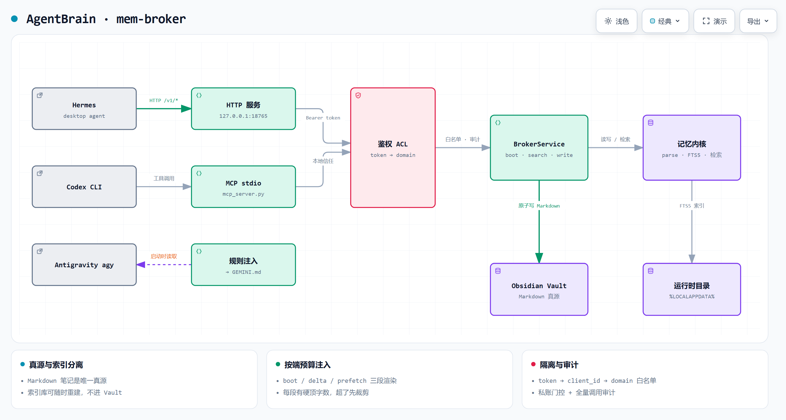

# AgentBrain · mem-broker

跨端共享的本地记忆中枢：**Markdown 是唯一真源，SQLite FTS5 是可随时重建的索引，人格与热记忆按端预算注入。**

Hermes、Codex、Antigravity 这类 CLI/agent 各自只有自己那份会话记忆——换个端就断片，同一件事还可能留下两份互相矛盾的结论。mem-broker 把长期记忆放进一个 Obsidian vault（人可读、可手改、能用 git 版本化），由一个本机 broker 统一负责解析、增量索引、检索与原子写入。客户端只问一句"这次对话相关的是哪几条"，拿到的是按预算裁剪过的片段，而不是整个知识库。



> 交互版（可搜索、聚焦节点、导出）：[`docs/architecture.html`](docs/architecture.html)。图由 [`docs/architecture.json`](docs/architecture.json) 生成。

## 核心设计

| 决定 | 理由 |
|---|---|
| 真源与索引分离 | Vault 里只有 Markdown。索引库、版本戳、审计、锁、日志全在 `%LOCALAPPDATA%/agentbrain/`，随时可删可重建，不进 vault、不进 git。 |
| broker 是唯一中枢 | 各端不直接读写 vault 的索引结构，只走 HTTP / MCP。谁能读什么、注入多少预算，只在 broker 一处定义。 |
| 中文用重叠二元组 | 不依赖 jieba 和外部词典：任意连续二字词（"幂等""幂等设计"）都确定性成词，没有版本漂移与冷加载开销。 |
| 索引层排除，而不是接口层门控 | "能进检索"就等于"能进上下文"。日记与未审外来卡片在扫描阶段就被排除，不靠下游接口自觉。 |
| 按端预算渲染 | 同一份记忆渲成 `boot` / `delta` / `prefetch` 三种块，每段有硬顶字数，超了先裁剪再注入。 |

## 架构走一遍

1. **接入层**：`server.py` 起标准库 HTTP 服务（默认 `127.0.0.1:18765`，只绑本地），`mcp_server.py` 起 MCP stdio 服务给 Codex / Antigravity 用；`agy_rules.py` 是第三条通道——把身份与热记忆渲染进 `~/.gemini/GEMINI.md`（路径可用 `broker.yaml` 的 `agy_rules_path` 覆盖，且只有 `role: primary` 才写），因为 agy 每次会话都会读这个文件。渲染的身份块含**自我陈述 + 特质 + 语气 + 外观**（不是只有特质清单），并把「运行于 X 框架」按端改写。该文件在服务启动时刷一次，之后**任一写操作（`memory_write` / `handoff_upsert` / `diary_append`）改变 revision 就立即重渲染**（文件级 diff，变了才写），所以 agy 下次开会话拿到的是最新热记忆，而不是上个阶段的快照。
2. **鉴权**：`tokens.json` 只存 token 的 sha256，`Bearer` → `client_id` → `memory.yaml` 里的 `domain` 与 `can_casual`。私账读取额外受 `diary.gate` 约束。
3. **服务层** `BrokerService`：`boot` / `delta` / `search` / `read` / `write` / `handoff` / `diary` 七个动作，写入走"原子替换 + 重新索引"。
4. **内核**：`parse.py` 解析 frontmatter 与 `[[wikilink]]`（含类型化关系），`segment.py` 做 CJK 重叠二元组，`index.py` 维护 FTS5 增量索引与事实键收敛，`retrieve.py` 做证据打分 + 1 跳图谱扩散 + 预算裁剪，`render.py` 负责三段渲染。

## 快速开始

前提：Python ≥ 3.11，一份 Markdown 目录（Obsidian vault 最佳）。

```bash
git clone https://github.com/ghoststarz/agentbrain.git
cd agentbrain
python -m venv .venv
.venv/Scripts/activate          # POSIX: source .venv/bin/activate
pip install -e ".[dev]"
```

两份配置，都在 vault 之外：

```bash
# 1) 机器配置：vault 根、SOUL 指针、运行时目录
cp examples/broker.yaml.example "$LOCALAPPDATA/agentbrain/broker.yaml"
# 2) 记忆域策略：ACL、注入预算、检索参数
cp examples/memory.yaml.example "<vault_root>/profiles/<profile>/memory.yaml"
```

然后：

```bash
python -m agentbrain init       # 建运行时目录 + 索引库
python -m agentbrain reindex    # 扫描 vault，增量建索引
python -m agentbrain search "中文检索 二元组"
python -m agentbrain status     # 笔记数、revision、索引年龄
python -m agentbrain doctor     # 环境检查 + SOUL 漂移诊断
```

起服务：

```bash
python -m agentbrain serve --host 127.0.0.1 --port 18765   # HTTP
python -m agentbrain mcp-stdio --client-id codex           # MCP over stdio
python -m agentbrain sync-agy                              # 重渲染 ~/.gemini/GEMINI.md
```

配置路径可用环境变量覆盖：`AGENTBRAIN_BROKER_CONFIG`（broker.yaml）、`AGENTBRAIN_TOKENS_PATH`（tokens.json）、`AGENTBRAIN_CLIENT_ID` / `AGENTBRAIN_TOKEN`（stdio 进程身份）。

## HTTP API

除 `/healthz` 外都要求 `Authorization: Bearer <token>`。

| 方法 | 路径 | 说明 |
|---|---|---|
| GET | `/healthz` | 存活探针，返回当前 revision（不鉴权） |
| GET | `/v1/status` | 索引计数、revision、索引年龄 |
| POST | `/v1/boot` | 启动块：人格摘要 + 协议 + 热记忆，按 `inject.<client>.boot_chars` 裁剪 |
| POST | `/v1/delta` | 自某个 revision 以来的增量块 |
| POST | `/v1/search` | FTS5 + 1 跳图谱扩散检索；按会话返回一次性后台评审完成回执 `review_receipts` |
| POST | `/v1/read` | 读整篇笔记或指定标题块 |
| POST | `/v1/write` | 原子写入笔记并重新索引 |
| POST | `/v1/handoff` | 读/写结构化接力卡 |
| POST | `/v1/diary` | 公账/私账日记追加与读取 |

## MCP 工具

`memory_boot`、`memory_delta`、`memory_search`、`memory_read`、`memory_write`、`memory_status`、`handoff_read`、`handoff_upsert`、`diary_append`、`diary_read`。

## 宿主接入：Hermes MemoryProvider

MCP 是"agent 主动来查"的通道，Hermes 需要的是"每轮自动送过去"。这两种语义不一样，所以仓库里另带一份 Hermes 插件：[`integrations/hermes/obsidian-broker/`](integrations/hermes/obsidian-broker/)——单文件、无第三方依赖的 `MemoryProvider` 实现：

- `prefetch` 在每次用户输入前打 `POST /v1/search`，命中注入成 `[MEMORY_PREFETCH]` 块（1200 字硬顶，revision 变了多带一行 delta）；仅当后台记忆整理任务完成时，在下一轮注入一次性 `[PREVIOUS_REVIEW_RESULT]` 完成回执并立即 ack，其余轮次保持静默；
- `system_prompt_block` 给出静态协议，这是每轮都在上下文里的那一层；
- `on_pre_compress` 在上下文压缩前把当前任务 upsert 成 `handoff` 槽位，压缩后不丢线；
- `get_tool_schemas` 返回空——不往会话里塞额外工具面；
- 每个钩子 fail-open，broker 没起时静默降级，对话不受影响。

装法、token 来源、排查看该目录的 README。

另外还有一个纯 UI 的桌面插件 [`integrations/hermes/diary-note/`](integrations/hermes/diary-note/)：日记写完后在会话里渲染一行 `📔 公账已记 16:11 · …`，用的是桌面端的 `transcript.directives` 贡献区（和核心 `::preview` 同一套机制），所以没有后端、不发请求、不轮询——一个单文件、100 行。内置那条金色「自我改进回顾」行属于核心的 `review.summary` 事件，插件无法写入，这里用 directive 在消息内复刻同样的观感。

## 检索是怎么排序的

召回分三段，按价从高到低：

- **第 0 段 常驻**：人格摘要 + 跨端仲裁协议 + `HOT.md` 热记忆，每轮必带，固定预算。
- **第 1 段 触发**：笔记 frontmatter 自带的 `keys` / `keys2` 命中即注入——精确、可解释、不吃 FTS。
- **第 2 段 检索**：FTS5 + CJK 二元组 + 标题加权兜底，命中带 `weak_evidence` 标记。

打分组成：token IDF 稀有度 × 标题/键权重 × 时效衰减（半衰期默认 30 天）× 作废惩罚（`superseded_penalty`），低于 `min_evidence` 的命中不会伪装成强证据，客户端可以选择整段不注入。

## 三条安全边界

1. **索引层排除**：`30_Diary`（只写不读的账本，唯一读取路径是受 gate 控制的 `diary_read`）、`90_Archive` 与 `50_Inbox/new`（已下线功能的遗留安全护栏）在扫描阶段硬排除。
2. **鉴权**：`tokens.json` 只存哈希，映射到 `client_id` 后按 `memory.yaml` 的 `domain` / `can_casual` 判权。
3. **审计**：每次调用记 `client / tool / scope / allowed / digest`，落在运行时的 `audit/` 目录下。

## 仓库结构

```
agentbrain/            内核与服务
├── config.py          broker.yaml + memory.yaml 加载与路径解析
├── parse.py           frontmatter 契约、Wikilink 与类型化关系提取
├── segment.py         CJK 重叠二元组 / ASCII 小写分词
├── index.py           SQLite FTS5 增量索引、事实键收敛、永不索引目录
├── retrieve.py        证据打分、1 跳图谱扩散、预算裁剪
├── render.py          boot / delta / prefetch 三段渲染
├── server.py          BrokerService + 标准库 HTTP 服务
├── mcp_server.py      MCP stdio 服务
├── acl.py             Bearer → client_id → domain
├── diary.py           公/私账日记（gate 门控）
├── handoff.py         接力卡（handoff.json）读写
├── agy_rules.py       渲染 ~/.gemini/GEMINI.md
├── atomic.py          原子写 + 跨进程文件锁
├── proactive.py       主动整理调度核心（事件/分块/窗口/租约）
├── proactive_adapters.py  Hermes / agy IDE / CLI 事件适配器
├── proactive_hermes.py    Hermes 运行时发现与安全桥接调用
├── proactive_worker.py    后台评审分段、模型路由与投影调度
├── proactive_apply.py     受限操作校验与原子投影写入
├── proactive_runner.py    单写者耐久租约后台循环
├── integrations/      随包发布的桥接脚本（hermes_review_bridge.py）
├── serve.py           serve / mcp-stdio 子命令
└── cli.py             命令行入口

tests/                 单元与隔离性回归测试
docs/                  架构图规格（architecture.json）与渲染产物
examples/              配置样例
integrations/          宿主侧接入（hermes/obsidian-broker 记忆 provider；hermes/diary-note 桌面插件）
scripts/               Windows 计划任务自愈脚本
```

vault 侧约定（`<vault_root>/profiles/<profile>/`）：

```
memory.yaml            记忆域策略
00_Identity/           USER.md 用户画像、RULES.md 跨端仲裁协议
10_Working/            HOT.md 热记忆（硬顶字数）、.state/handoff.json 接力卡
20_LongTerm/           Projects / Decisions / Facts / Entities / MOC
30_Diary/              Public 公账、Private 私账（不进索引）
```

## 测试

```bash
pip install -e ".[dev]"
pytest -q                                                                 # 102 passed, 8 skipped（插件测试默认跳过）
AGENTBRAIN_PLUGIN_PATH=integrations/hermes/obsidian-broker/__init__.py pytest -q  # 110 passed
```

默认 102 项通过、8 项跳过——跳过的是 Hermes 插件侧的 prefetch 与 outbox 测试。把 `AGENTBRAIN_PLUGIN_PATH` 指向 [`integrations/hermes/obsidian-broker/__init__.py`](integrations/hermes/obsidian-broker/__init__.py) 后全部 110 项都会运行。

其中一组是隔离性回归：日记写入后检索 0 命中、启动块不含日记、`reindex` 后笔记数不因日记增长。

## 主动记忆整理（Proactive Review，默认关闭）

在 `memory.yaml` 中显式开启 `proactive.enabled: true` 后，broker 可在后台按**每 5 轮人类对话增量触发**与**本地 23:00 夜间窗口**整理对话证据并受限投影到长期记忆与日记：

- **默认复用 Hermes 框架路由**：通过随包发布的隔离桥接脚本（[`agentbrain/integrations/hermes_review_bridge.py`](agentbrain/integrations/hermes_review_bridge.py)）发现 Hermes 受管 Python（`installs/*/facts.json`），以 `HERMES_DISABLE_LAZY_INSTALLS=1`、无工具、纯结构化 JSON 模式调用 `agent.auxiliary_client.call_llm(task="background_review", ...)`，复用 `auxiliary.background_review` 或主 profile 模型与框架鉴权，无需额外配置端点或密钥（也保留可选 `model_backend: "openai_compatible"` 向后兼容）。
- **多源基线采集**：支持 Hermes `obsidian-broker` 插件持久化 outbox、可选 `agy` IDE `transcript.jsonl` 增量扫描（首次默认从 EOF 建立基线，不追溯历史），以及 `review-cli-event`。
- **受限安全投影**：只允许 `longterm_upsert` / `project_update` / `hot_update` / `handoff_upsert` / `diary_append` / `no_change`，禁止修改 `SOUL.md` / `USER.md` / `RULES.md` 与配置文件，并发冲突由 `expected_hash` 拦截，详情见 [`docs/proactive-stage2-handoff.md`](docs/proactive-stage2-handoff.md)。

## 已知边界

- Windows 优先：文件锁走 `msvcrt`，脚本是计划任务；POSIX 分支有实现但未实测。
- 单人单机单 vault：没有冲突合并协议，两个 broker 同时写同一 vault 没有保护。
- `integrations/hermes/obsidian-broker/` 只依赖 HTTP 契约，不 import broker 的包；契约变了必须两边一起改，这是唯一的耦合点。本机是通过目录联接（junction）把 profile 的 plugins 目录指到这里的，删掉仓库那份插件就会一起消失。
- 已完成一次真实 Hermes 框架模型桥接调用（无记忆写入），并在本机启用采集、建立 IDE 历史尾随基线；真实五轮写入质量与 23:00 跨夜触发仍待持续验证。
- Codex 侧接线已就位，但受其自身模型配置限制。

## License

MIT
